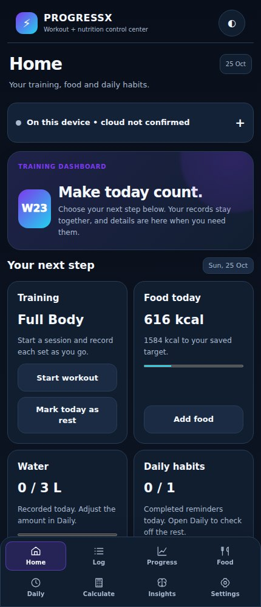
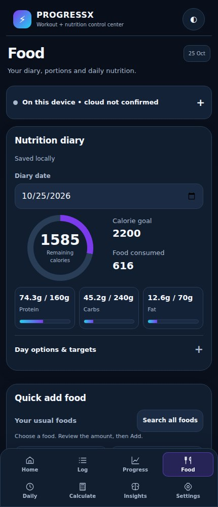
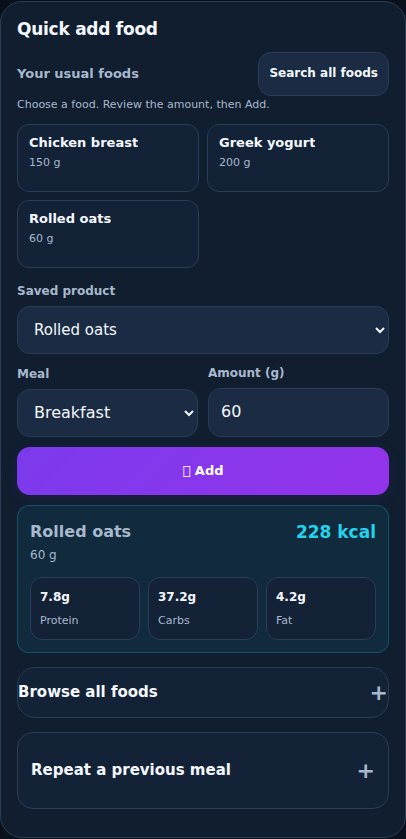
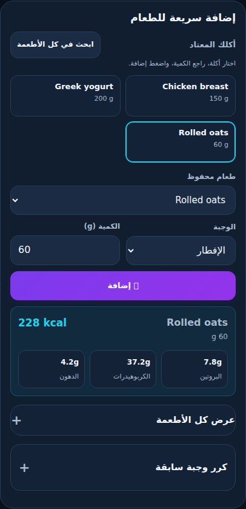
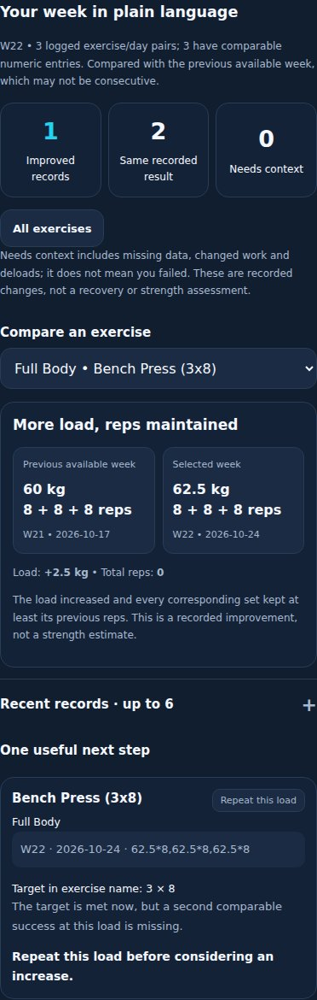
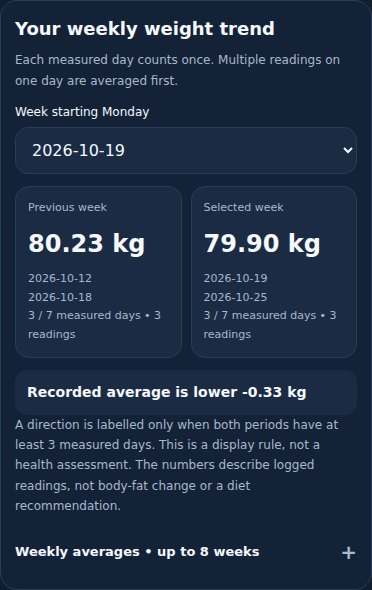
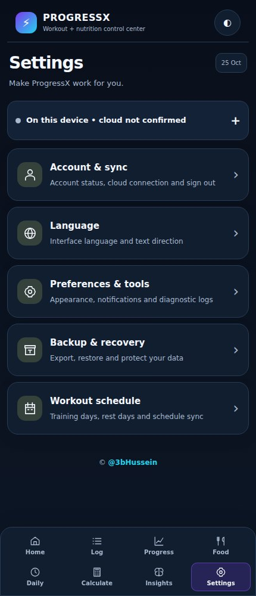
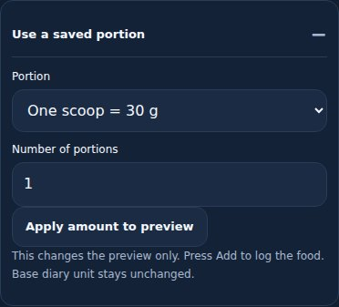
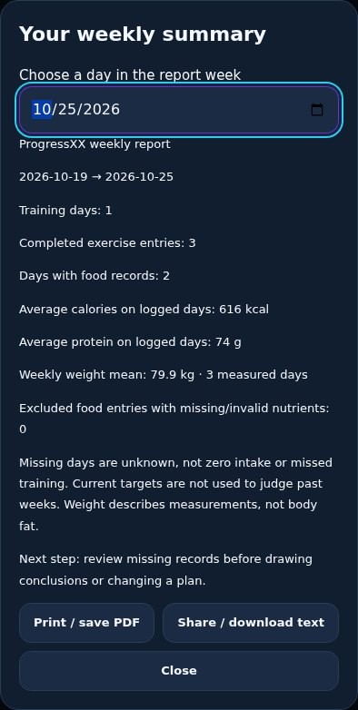
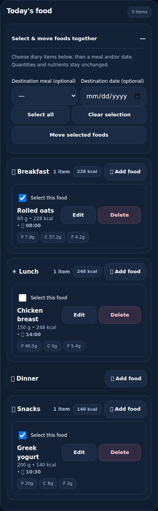

<div align="center">

# ProgressXX

### Train. Log. Understand your progress.

A mobile-first workspace for workouts, meals, body-weight check-ins and daily habits — with English and Arabic interfaces.

**تمارينك وأكلك وقياساتك في مكان واحد، بواجهة مناسبة للموبايل بالعربي والإنجليزي.**

[**Open ProgressXX**](https://3bhussein.github.io/ProgressXX-Web/) · [Roadmap](ROADMAP.md) · [Development log](docs/DEVELOPMENT-LOG.md) · [Project handoff](docs/PROJECT-HANDOFF.md)

</div>

> **Project status · 26 October 2026:** personal-use application under active development. The current frontend has passed automated Chromium, Firefox and WebKit checks. Production security, complete real-account/device acceptance and commercial readiness remain separate, open milestones.

## A look inside

These are screenshots of the actual `index.html` interface, captured locally with **synthetic demonstration data**. They contain no personal workout history or account information. The example clock is fixed to 25 October 2026; cloud status is intentionally unconfirmed in the local fixture.

| Home — your next action | Food — your day at a glance |
| :---: | :---: |
|  |  |
| **Quick add — review the portion first** | **Arabic — the same flow in RTL** |
|  |  |
| **Progress — compare recorded work** | **Weight — compare weekly averages** |
|  |  |

<details>
<summary><strong>Settings and screenshot provenance</strong></summary>



Screenshots use a disposable in-memory store, no login and blocked external requests. The capture script does not alter production data or the app source. The [manifest](docs/screenshots/manifest.json) records the source checksum, example date, viewport and captured region for each image.

</details>

<details>
<summary><strong>New: portions, batch moves and shareable reports</strong></summary>

| Saved portion conversion | Weekly report |
| :---: | :---: |
|  |  |



</details>

## What you can do

| Area | Everyday use |
| --- | --- |
| **Home** | Start or resume training, log food, update water and check daily habits. Extra summaries stay behind disclosures. |
| **Workout log & sessions** | Organize training days, launch templates and record sets. Numeric sets and free text are supported; partial entries are guarded. Unfinished session drafts can be resumed. |
| **Food** | See daily calories/macros, choose a saved product and review its quantity before adding. Usual-food shortcuts recall the last compatible portion; search, barcode, saved meals and repeat-meal tools remain available. |
| **Progress** | Compare an exercise's recorded sets with an earlier available week. See a plain-language review and an explainable next step, with deload and missing-data context. |
| **Weight** | Log check-ins and compare calendar-week averages, with date ranges, measured days and reading counts. Individual readings and the weight goal remain accessible. |
| **Daily** | Track reminders, completion and water in a mobile-friendly view. |
| **Insights & anatomy** | Start with concise summaries, then open detailed evidence, exercise links or the muscle reference when needed. |
| **Settings** | Manage interface language, appearance, account/sync, backups, diagnostics and the workout schedule. |

### Recent improvements

- **Quieter Food page:** summary, Quick add and meals are expanded; the library and secondary tools open on demand. Empty meal rows and usual-food cards take less space.
- **Faster meal logging:** usual foods from the last 30 days of loaded history, exact product/unit matching, remembered portions and previous-meal previews.
- **Food Undo:** a two-minute window for supported additions, repeated-meal batches and diary deletions, with guards against undoing a later edit.
- **Clearer save state:** distinguish local records, unfinished drafts, known pending changes and acknowledged cloud saves. Conflicts use the existing review path.
- **Readable progress:** recorded comparisons explain what changed; mixed/free-text work and deload weeks do not force an increase verdict.
- **Weekly weight:** daily means contribute equally to the weekly mean. Incomplete weeks compare matching weekdays, and limited data is labelled.
- **Mobile and language:** eight destinations, touch-sized controls, responsive layouts, English/Arabic and RTL support.

## A simple daily flow

1. Open **Home** and choose the next useful action.
2. Start a workout, or open **Food** to choose a product, check the amount and press **Add**.
3. Use **Daily** for habits and water; add a weight check-in in **Progress** when needed.
4. Review the recorded weekly comparison and its explanation. Open detailed history only when it helps.
5. Check save status and keep a JSON backup through **Settings → Backup & recovery**.

Weight trends describe recorded measurements, not body-fat changes or a diet prescription. Exercise comparisons describe recorded work, not a recovery or medical assessment. Calculation rules and limits are documented in [Recorded progress](docs/RECORDED-PROGRESS.md), [Weekly weight & usual foods](docs/WEEKLY-WEIGHT-USUAL-FOODS.md) and [Insights logic](docs/INSIGHTS-LOGIC-AUDIT.md).

## How it works

The production application is the root **`index.html`**, served through GitHub Pages. Browser-local storage supports local state and drafts; account-oriented data synchronization uses the existing backend integration. JSON export/import, offline queues and conflict review have dedicated regression coverage. Local-only drafts and queue status must not be confused with a confirmed cloud backup.

| Path | Purpose |
| --- | --- |
| `index.html` | Production application; the target for frontend changes |
| `sw.js`, `manifest.webmanifest` | PWA/service-worker configuration |
| `tests/`, `scripts/` | Regression checks, release helpers and documentation capture |
| `.github/workflows/` | Full UI, cross-browser, safety and gated Pages workflows |
| `docs/screenshots/` | Current documentation images and capture manifest |
| `docs/` | Feature rules, audits, acceptance evidence and handoff |
| `supabase/migrations/` | Database migration sources; review safety and authorization before use |
| `full-app.html`, `commercial-v1.html` | Alternate/legacy sources; **not the production entry point** |

### Run locally

```bash
python3 -m http.server 8765 --bind 127.0.0.1
```

Open `http://127.0.0.1:8765/`. The normal app still uses its sign-in flow. Do not put credentials or personal exports into the repository.

To reproduce the documentation screenshots in a disposable local browser, install the pinned browser tooling and run the capture script while the local server is running:

```bash
npm install --no-save playwright@1.55.0
npx playwright install chromium --only-shell
node scripts/capture-readme-screenshots.cjs
```

The capture script is a **local development tool** that injects demonstration fixtures into a new browser context. It is not a guest mode or an authentication feature of the published application.

## Validation and release status

The current runtime release is [`8160cff`](https://github.com/3bHussein/ProgressXX-Web/commit/8160cffa3033978aef8020a3cca57e4f12b4833d). Its [Full UI](https://github.com/3bHussein/ProgressXX-Web/actions/runs/40234495193), [Fast safety](https://github.com/3bHussein/ProgressXX-Web/actions/runs/40234495194), [Firefox/WebKit](https://github.com/3bHussein/ProgressXX-Web/actions/runs/40234495200) and [Pages](https://github.com/3bHussein/ProgressXX-Web/actions/runs/40234495328) runs succeeded. The deployed root was downloaded and compared byte-for-byte with the tested source. The development log records the initial failures and successful reruns.

Coverage includes synthetic workout/food actions, portions, Undo, reload, drafts, offline retry, backup/import, mocked-account save/reload/logout, keyboard controls and EN/AR mobile layouts. **Automated fixtures do not certify every real-account or physical-device scenario.**

### Remaining milestones

| Priority | Remaining work |
| --- | --- |
| **Account & data safety** | Independently verify server-side authorization/account isolation and complete recovery/conflict acceptance in an explicitly isolated environment. |
| **Real devices** | Complete Android/PWA, camera/barcode, keyboard, lifecycle and screen-reader checks with a controlled checklist. |
| **Product clarity** | Validate the simpler daily flow with actual use before adding more controls; improve terminology and empty states where users get stuck. |
| **Operations & commercial readiness** | Privacy, account/data deletion, recovery procedures, monitoring, support and commercial release gates. |

### Portions, organization and fewer repeated steps

- **Saved portions:** in Food → Manage food library → Portions & library organization, define a name and its quantity in the product's existing base unit. In Quick add, choose that portion and its count, then apply it to the preview. Press **Add** separately to log it. There are no guessed gram/piece/pack conversions; a changed base unit invalidates incompatible saved portions.
- **Library organization:** review possible duplicates by barcode or normalized name, and archive/restore products from quick choices. No automatic merge, deletion or rewrite of past diary entries.
- **Batch move:** open Today's food → Select & move foods together. Select entries and a destination meal/date. Quantities, nutrients, IDs and recorded times stay unchanged. Known pending, in-flight or conflicting writes are guarded; successful local moves enter the existing durable upload queue.
- **Weekly report:** open Progress → Weekly report / share. Choose a week, print/save PDF, or share/download its text. Nutrition averages use days with valid logged entries; missing days remain unknown. Old weeks are not judged against current targets.
- **Visible sections:** in Settings → Preferences & tools, choose optional Food/Insights sections. Core logging and save/recovery controls remain available; direct library search can reveal a hidden library for the current task.

Saved portions, archive choices and section visibility are **device-local, separated by account**. They are not sent to cloud snapshots or included in the JSON backup. Core diary changes retain the existing persistence path. See [Food workflow tools](docs/FOOD-WORKFLOW-TOOLS.md) for boundaries and validation. The updated runtime is awaiting its required same-commit CI and Pages checks; the runtime evidence above remains the previously deployed baseline until the development log records publication.

## Engineering and data-preservation rules

1. Target the root production app and preserve existing features and user history. Never reset tables or browser records without an explicit backup/migration plan.
2. Changes to Food, Daily, Workout, schedules, weight or login need appropriate add/edit/delete, reload, account-isolation and synchronization coverage. Report the scope of the evidence precisely.
3. Run relevant checks and honor the exact-commit deployment gate. A successful edit or visible feature is not proof of deployment.
4. Use PR review for risky changes. Never commit credentials, service-role keys or real user records.
5. Record the problem, change, validation, deployed commit and remaining limits. Offline replay, deletion tombstones and conflicts must preserve user changes.
6. Enforce ownership and authorization on the server. Public frontend code cannot secure secrets or enforce paid plans independently.
7. Database experiments remain paused unless separately authorized under the project's existing controls. Do not execute migrations as part of normal frontend work.
8. After each change, update [DEVELOPMENT-LOG](docs/DEVELOPMENT-LOG.md), [PROJECT-HANDOFF](docs/PROJECT-HANDOFF.md) and [ROADMAP](ROADMAP.md). Do not mark unverified work complete.

### Resume development

> Read README.md, ROADMAP.md, docs/DEVELOPMENT-LOG.md and docs/PROJECT-HANDOFF.md on main. Check the current source, relevant open PRs and recent Actions. Work on the root production index.html, preserve all data, implement the requested scope, run appropriate regression checks and update the handoff. Distinguish local fixtures, automated checks, live deployment and real-device acceptance.

## Commercial release and license

Public paid launch remains blocked on the project's account/security, persistence, real-device, recovery, privacy and operations gates. A functioning UI does not close those milestones.

No license has been declared. Public repository visibility does not automatically grant permission to reuse or resell the code.
